# Page hierarchy and flow

Map of routed pages: **URL path**, **component**, and **folder** under `src/app`. Update this file when a route or page folder is added or renamed.

Related: [angular-structure.md](./angular-structure.md) (placement rules).

## Table of contents

- [Page hierarchy and flow](#page-hierarchy-and-flow)
  - [Table of contents](#table-of-contents)
  - [Route → page → location](#route--page--location)
  - [Hierarchy (modules and folders)](#hierarchy-modules-and-folders)
  - [Navigation / page flow](#navigation--page-flow)
  - [Router load tree](#router-load-tree)
  - [Pages — panel diagrams](#pages--panel-diagrams)
    - [1. `/login` — `login-page`](#1-login--login-page)
    - [2. `/login-callback` — `login-callback-page`](#2-login-callback--login-callback-page)
    - [3. `/dashboard` — `dashboard-home-page`](#3-dashboard--dashboard-home-page)
    - [4. `/model-strip` — `model-strip-page`](#4-model-strip--model-strip-page)
    - [5. `/color-table` — `color-table-page`](#5-color-table--color-table-page)
    - [6. `/industry` — `industry-home-page`](#6-industry--industry-home-page)
    - [7. `/industry/manufacture` — `manufacture-home-page`](#7-industrymanufacture--manufacture-home-page)
    - [8. `/industry/manufacture/blueprints` — `v1-blueprint-by-location-page`](#8-industrymanufactureblueprints--v1-blueprint-by-location-page)

## Route → page → location

| URL | Guard | Page selector | Folder |
| --- | --- | --- | --- |
| `/` | — | → redirect `dashboard` | — |
| `/login` | — | `login-page` | `pages/login-page` |
| `/login-callback` | — | `login-callback-page` | `pages/login-callback-page` |
| `/dashboard` | `authGuard` | `dashboard-home-page` | `pages/dashboard-home-page` |
| `/model-strip` | — | `model-strip-page` | `pages/model-strip-page` |
| `/color-table` | — | `color-table-page` | `pages/color-table-page` |
| `/industry` | — | `industry-home-page` | `modules/industry/pages/industry-home-page` |
| `/industry/manufacture` | — | `manufacture-home-page` | `modules/industry/manufacture/pages/manufacture-home-page` |
| `/industry/manufacture/blueprints` | — | `v1-blueprint-by-location-page` | `modules/industry/manufacture/pages/v1-blueprint-by-location-page` |

## Hierarchy (modules and folders)

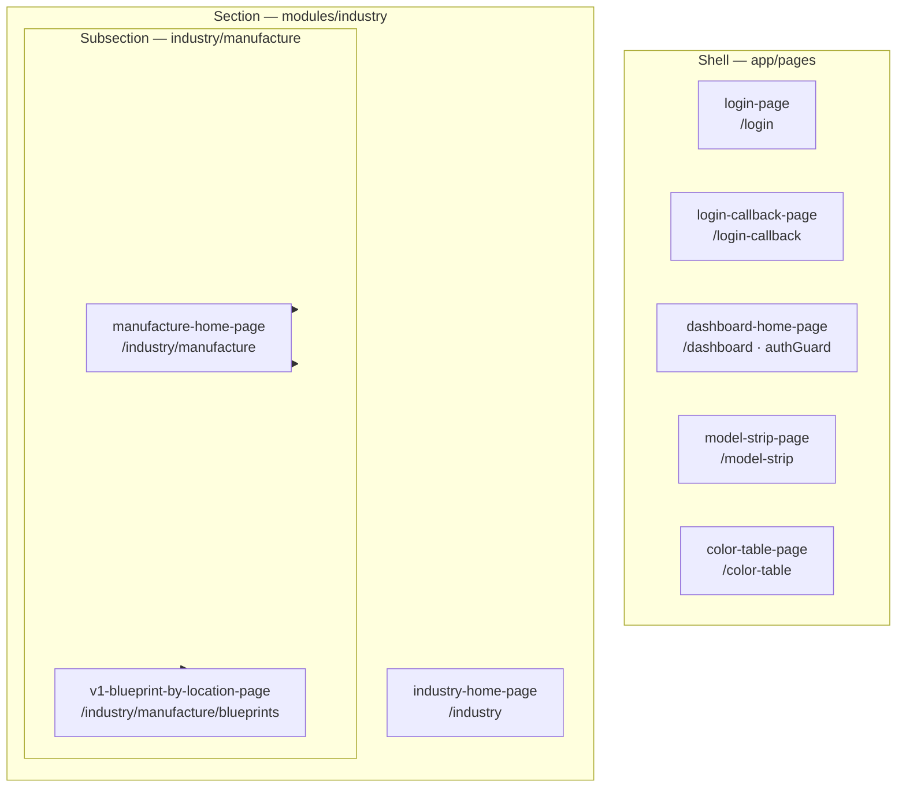

## Navigation / page flow

Intended user flow (Feature panel targets and auth). Dashed edges are development-only or not yet wired from the UI.

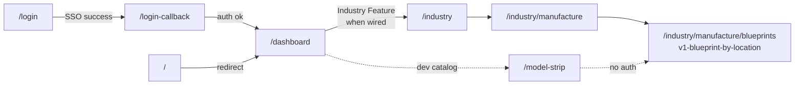

## Router load tree

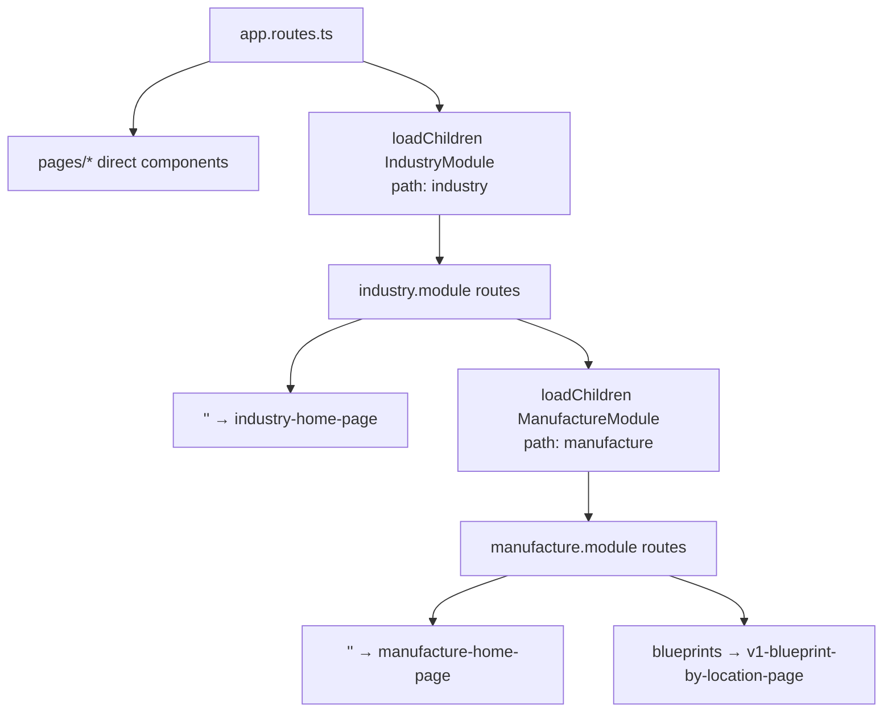

## Pages — panel diagrams

Per-page layout: numbered **sections** (top → bottom) with **panel / section identifiers** (`cy-section-name` or selector). Nested boxes are panels or renders hosted inside a section. Update the matching subsection when a page’s panel stack changes.

### 1. `/login` — `login-page`

| # | Identifier | Kind | Notes |
| --- | --- | --- | --- |
| 1 | `header` | `app-page-header` | Variant `-AUTH-` → `v1-application-info-render` |
| 2 | `login` | login panel | Title + validation message **or** EVE SSO button |
| 3 | `footer` | footer | Copyright line |

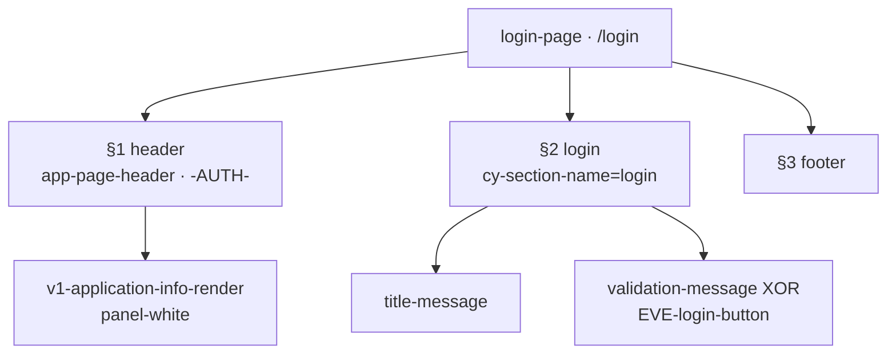

### 2. `/login-callback` — `login-callback-page`

| # | Identifier | Kind | Notes |
| --- | --- | --- | --- |
| 1 | `header` | `app-page-header` | Variant `-AUTH-` |
| 2 | `login-validation-progress` | progress panel | Waiting message + auth code |
| 3 | `login-validation-exception` | exception panel | Only when exception present |

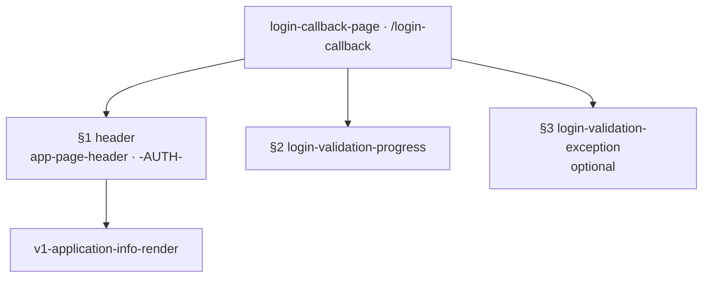

### 3. `/dashboard` — `dashboard-home-page`

Secured landing page. **Target** layout (EPIC-006); current seed still has pilot only under `pilot-dashboard` (corporation / breadcrumb / feature list pending).

| # | Identifier | Kind | Notes |
| --- | --- | --- | --- |
| 1 | `header` | `app-page-header` | Variant `-APP-` → application-info + server-status |
| 2 | `exception` | exception region | Optional; under header when present |
| 3 | `pilot-dashboard` | pilot & corporation row | Left: `v1-pilot-panel` · Right: `v1-corporation-render` (target) |
| 4 | `breadcrumb` | breadcrumb row | Target — navigable trail from Dashboard |
| 5 | `feature-list` | feature listing panel | Target — provider + `v1-feature-button` |

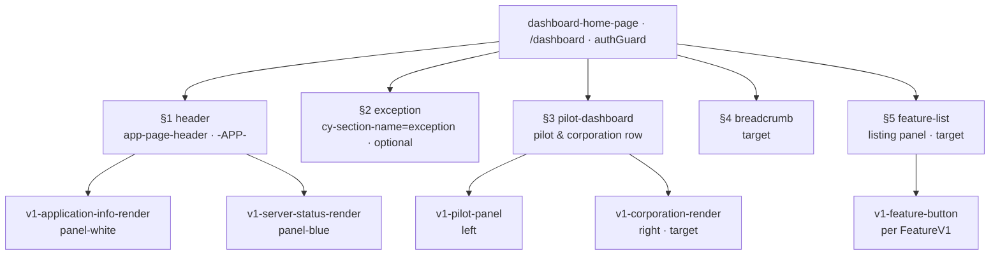

### 4. `/model-strip` — `model-strip-page`

Dev catalog (no `authGuard`). Body is a vertical **strip** of specimen rows; each row is visual + meta (`render-ref`). Identifiers use `data-specimen`.

| # | Identifier (`data-specimen`) | Kind |
| --- | --- | --- |
| 1 | `font-reference` | face sizing sample |
| 2 | `v1-corporation-render` | corporation HEADER card |
| 3 | `v1-system` | system hierarchy card |
| 4 | `v1-region` | region hierarchy card |
| 5 | `legacy-v2-feature-render` | historical Feature strip |
| 6 | `legacy-v1-feature-button` | Feature button candidate |
| 7 | `v1-public-pilot` | PublicPilot HEADER |
| 8 | `v2-pilot` | PilotV2 HEADER |
| 9 | `v1-blueprint` | BlueprintV1 identity |
| 10 | `v1-blueprint-short` | processed blueprint short |
| 11 | `v1-blueprint-detailed` | processed blueprint detailed |
| 12 | `v1-bomresource` | BOM resource |
| 13 | `v1-bomresource-action` | BOM resource + action |
| 14 | `v1-bomgroup` | BOM group |
| 15 | `v1-application-info-render` | application info |
| 16 | `v1-server-status-render` | server status |

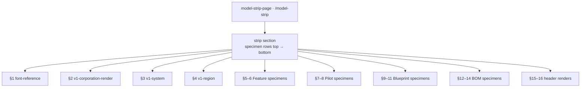

### 5. `/color-table` — `color-table-page`

| # | Identifier | Kind | Notes |
| --- | --- | --- | --- |
| 1 | `header` | `app-page-header` | Variant `-APP-` |
| 2 | `color-table` | page body | Palette groups + swatch rows (`data-palette-key`) |

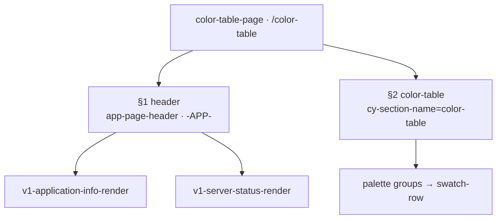

### 6. `/industry` — `industry-home-page`

| # | Identifier | Kind | Notes |
| --- | --- | --- | --- |
| 1 | `header` | `app-page-header` | Variant `-APP-` |
| 2 | `industry-home` | section body | Title + link to manufacture |

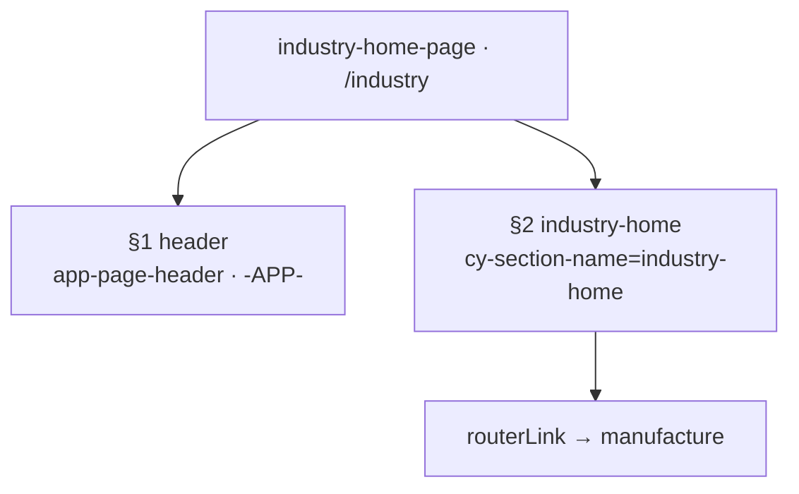

### 7. `/industry/manufacture` — `manufacture-home-page`

| # | Identifier | Kind | Notes |
| --- | --- | --- | --- |
| 1 | `header` | `app-page-header` | Variant `-APP-` |
| 2 | `manufacture-home` | section body | Hosts available-blueprints panel |
| 3 | `available-blueprints-panel` | panel | Selector `available-blueprints-panel` |

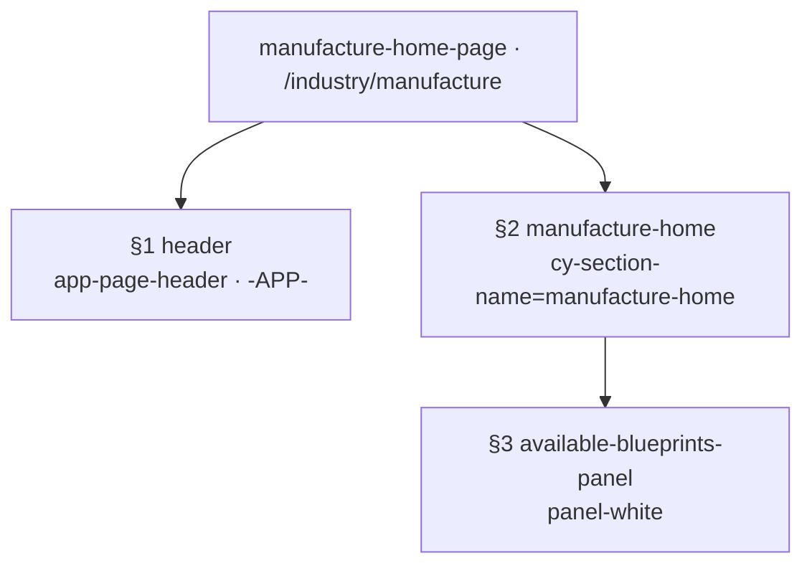

### 8. `/industry/manufacture/blueprints` — `v1-blueprint-by-location-page`

| # | Identifier | Kind | Notes |
| --- | --- | --- | --- |
| 1 | `header` | `app-page-header` | Variant `-APP-` (no authGuard on this route) |
| 2 | `v1-blueprint-by-location` | page section | Title + lead |
| 3 | `blueprint-regions-panel` | host panel | Region → System → Blueprint hierarchy |

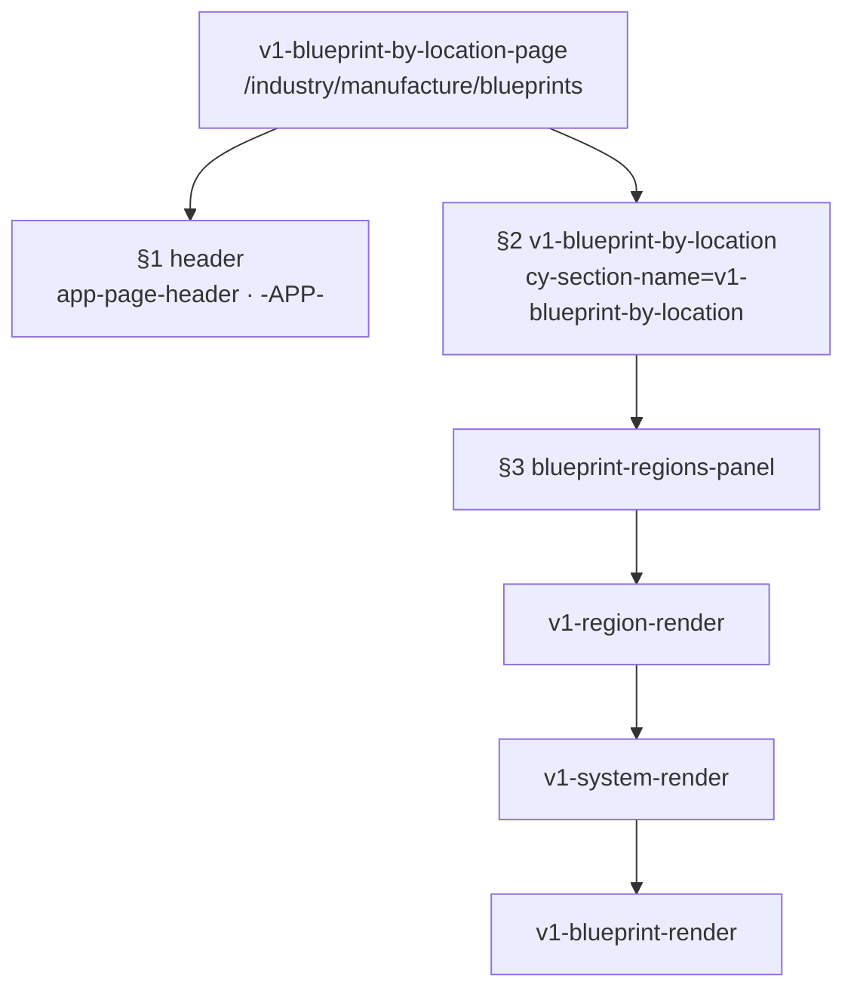
